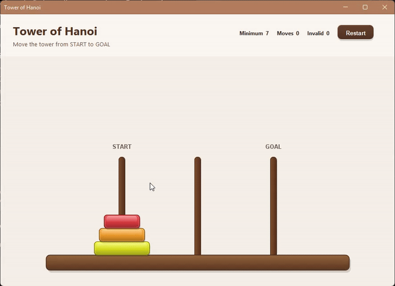
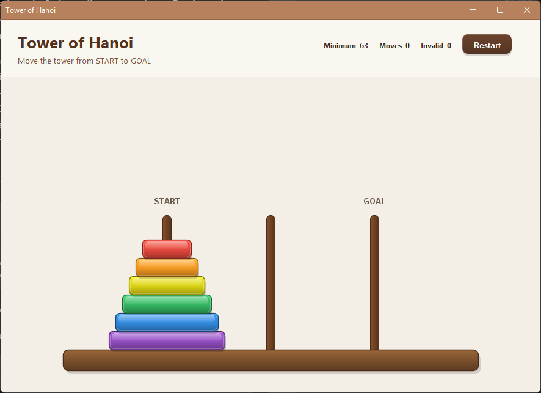
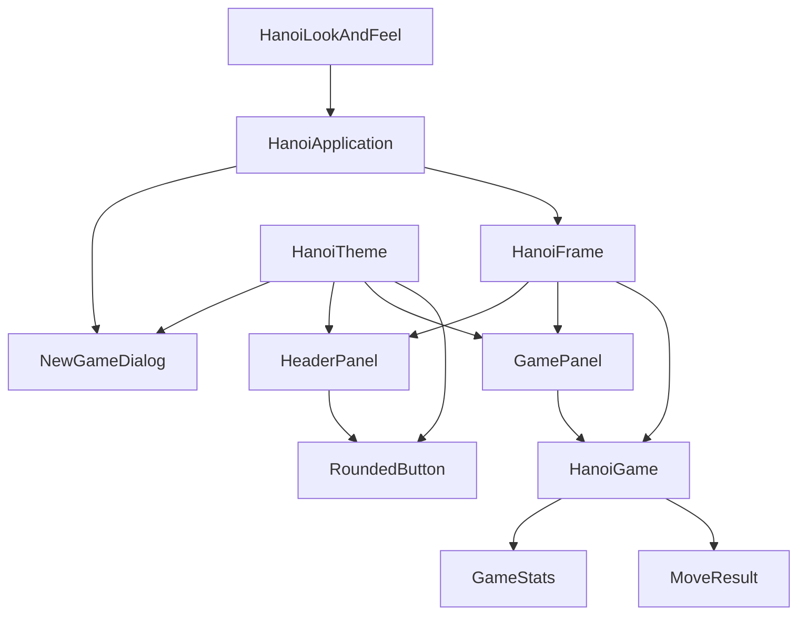

# Tower of Hanoi

<p align="center">
  <strong>A modern Java desktop implementation of the classic Tower of Hanoi puzzle.</strong>
</p>

<p align="center">
  Originally created as a recursion exercise and later rebuilt into a structured,
  tested and visually polished desktop application.
</p>

<p align="center">
  
</p>

<p align="center">
  
  
  
  
  
</p>

---

## About the project

The **Tower of Hanoi** is a classic mathematical puzzle composed of three rods and a set of disks with different sizes.

The objective is to move the entire tower from the **START** rod to the **GOAL** rod while respecting two rules:

- Only the top disk of a tower can be moved.
- A larger disk can never be placed on top of a smaller disk.

The theoretical minimum number of moves for a puzzle with `n` disks is:

```text
2ⁿ - 1
```

| Disks | Minimum moves |
| ---: | ---: |
| 1 | 1 |
| 2 | 3 |
| 3 | 7 |
| 4 | 15 |
| 5 | 31 |
| 6 | 63 |

This repository is more than an implementation of the puzzle itself.

The project originally started as a small academic exercise. It was later revisited and progressively refactored to explore **domain modeling, state encapsulation, automated testing, UI architecture, custom rendering and interaction design**.

---

## Interface

<p align="center">
  
</p>

The current interface includes:

- A custom wooden puzzle board rendered with Java `Graphics2D`
- Polished disk rendering with gradients, highlights and shadows
- Custom drag-and-drop interaction
- Game statistics displayed in real time
- Difficulty selection from 1 to 6 disks
- A custom visual theme
- FlatLaf integration for modern Swing window styling
- Responsive board positioning when the window is resized

---

## Highlights

### Game domain separated from the UI

The game rules and mutable state are contained inside `HanoiGame`.

Swing components do not directly manipulate the tower data structures. Instead, the UI requests immutable snapshots of the current tower state.

### Explicit move results

Moves return a `MoveResult` rather than a simple boolean.

This allows the application to distinguish between situations such as:

```text
SUCCESS
EMPTY_SOURCE
SAME_TOWER
LARGER_DISK_ON_SMALLER
```

This distinction is also useful for statistics and future visual feedback.

### Game statistics

`GameStats` tracks:

- Valid moves
- Invalid attempts
- The theoretical minimum number of moves
- Total attempts
- Extra moves beyond the theoretical minimum

### Geometry-based drag and drop

The game does not divide the screen into arbitrary invisible tower regions.

Instead, it compares:

```text
Dragged disk bounds
        +
Rod bounds
        ↓
Intersection detection
        ↓
Target tower
        ↓
HanoiGame validates the move
```

Because the collision area comes from the disk itself, larger disks naturally have a larger interaction area while smaller disks require more precise positioning.

### Automated tests

The game domain is tested independently from Swing using **JUnit 5**.

The current test suite covers:

- Initial game state
- Valid moves
- Invalid larger-on-smaller moves
- Empty source towers
- Same-tower moves
- Victory detection
- Disk-count validation
- Invalid tower indexes
- Statistics
- Game reset

---

## Architecture

The application separates the core game from the graphical interface and divides Swing responsibilities into focused components.



### Core domain

```text
game/
├── HanoiGame.java
├── GameStats.java
└── MoveResult.java
```

`HanoiGame` is responsible for:

- Maintaining the tower state
- Validating moves
- Executing valid moves
- Detecting victory
- Resetting the game
- Producing game statistics

The towers are internally modeled using `Deque<Integer>` structures.

The UI never receives the mutable collections directly.

### User interface

```text
ui/
├── components/
│   └── RoundedButton.java
│
├── dialogs/
│   └── NewGameDialog.java
│
├── theme/
│   ├── HanoiLookAndFeel.java
│   └── HanoiTheme.java
│
├── GamePanel.java
├── HanoiFrame.java
└── HeaderPanel.java
```

Each class has a focused responsibility:

| Component | Responsibility |
| --- | --- |
| `HanoiFrame` | Main application window and UI coordination |
| `GamePanel` | Board rendering, geometry and mouse interaction |
| `HeaderPanel` | Game statistics and controls |
| `NewGameDialog` | Initial disk-count selection |
| `RoundedButton` | Reusable custom button |
| `HanoiTheme` | Shared colors, fonts and visual constants |
| `HanoiLookAndFeel` | FlatLaf and window styling configuration |

---

## Project evolution

This project is a modernization of an older Tower of Hanoi implementation.

The goal was not to rewrite everything at once, but to improve the project incrementally while preserving working behavior.

| Earlier version | Current version |
| --- | --- |
| Game state inside the Swing frame | Dedicated `HanoiGame` domain |
| UI responsible for game rules | Domain validates and executes moves |
| `Stack<Integer>[]` directly manipulated by UI | Encapsulated `Deque<Integer>` structures |
| Boolean-style movement logic | Explicit `MoveResult` enum |
| No game metrics | Immutable `GameStats` |
| No automated tests | JUnit 5 test suite |
| Large Swing class with many responsibilities | UI split into focused components |
| Broad coordinate-based drop regions | Disk/rod geometry collision |
| Default Swing appearance | Custom rendering + FlatLaf |
| Basic input dialog | Custom game setup dialog |

This evolution turned a small academic exercise into a compact example of **incremental refactoring and software design**.

---

## Project structure

```text
tower-of-hanoi-java/
├── docs/
│   └── assets/
│       ├── tower-of-hanoi-demo.gif
│       └── tower-of-hanoi-screenshot.png
│
├── src/
│   ├── main/
│   │   └── java/
│   │       └── io/github/rafaelcsampaio/hanoi/
│   │           ├── app/
│   │           │   └── HanoiApplication.java
│   │           ├── game/
│   │           │   ├── GameStats.java
│   │           │   ├── HanoiGame.java
│   │           │   └── MoveResult.java
│   │           └── ui/
│   │               ├── components/
│   │               │   └── RoundedButton.java
│   │               ├── dialogs/
│   │               │   └── NewGameDialog.java
│   │               ├── theme/
│   │               │   ├── HanoiLookAndFeel.java
│   │               │   └── HanoiTheme.java
│   │               ├── GamePanel.java
│   │               ├── HanoiFrame.java
│   │               └── HeaderPanel.java
│   └── test/
│       └── java/
│           └── io/github/rafaelcsampaio/hanoi/game/
│               └── HanoiGameTest.java
│
├── .gitignore
├── mvnw
├── mvnw.cmd
├── pom.xml
└── README.md
```

---

## Running the project

### Requirements

- Java 17 or newer
- Git

A separate Maven installation is not required because the repository includes the **Maven Wrapper**.

Clone the repository:

```bash
git clone https://github.com/rafaelcsampaio/tower-of-hanoi-java.git
cd tower-of-hanoi-java
```

### Run the tests

On Windows:

```powershell
.\mvnw.cmd clean test
```

On Linux or macOS:

```bash
./mvnw clean test
```

### Run the application

Import the project as a Maven project in your Java IDE and execute:

```text
io.github.rafaelcsampaio.hanoi.app.HanoiApplication
```

The project was developed using Java 17.

---

## Tests

Run the complete test suite with:

```powershell
.\mvnw.cmd test
```

The domain tests are intentionally independent from the Swing interface, allowing the core puzzle rules to be validated without starting the graphical application.

---

## Roadmap

The current iteration focuses on delivering a polished implementation of the traditional Tower of Hanoi puzzle.

Possible future evolutions include:

- [ ] Animated recursive solver
- [ ] Smooth disk snapping and movement animations
- [ ] Animated return when an invalid move is attempted
- [ ] Game timer
- [ ] More detailed end-game statistics
- [ ] Packaged executable / GitHub Release
- [ ] Physical collision constraints between disks and rods
- [ ] Disk weight and gravity simulation
- [ ] Partial disk support and center-of-mass behavior
- [ ] Disk rotation based on physical balance
- [ ] 2.5D visual depth and rotation effects
- [ ] More advanced wooden board rendering

The more experimental physics ideas are intentionally outside the scope of the current version.

They remain documented here as possible future directions without increasing the complexity of the current implementation.

---

## Motivation

This project demonstrates the process of revisiting older code and improving it incrementally.

The focus was not only on creating a playable puzzle, but also on practicing:

- Software design
- Encapsulation
- Separation of responsibilities
- Data structures
- Automated testing
- Refactoring
- Event-driven desktop interfaces
- Custom rendering
- UI/UX decisions

---

<div align="center">

## Author

### Rafael Sampaio

**Software Engineering Student · Systems Development Technician**

Back-end Development · Software Architecture · Data & Automation

<a href="https://www.linkedin.com/in/rafael-sampaio-25554031a">
  
</a>
<a href="https://github.com/rafaelcsampaio">
  
</a>
<a href="mailto:rafael.sampaio.tech@gmail.com">
  
</a>

</div>
